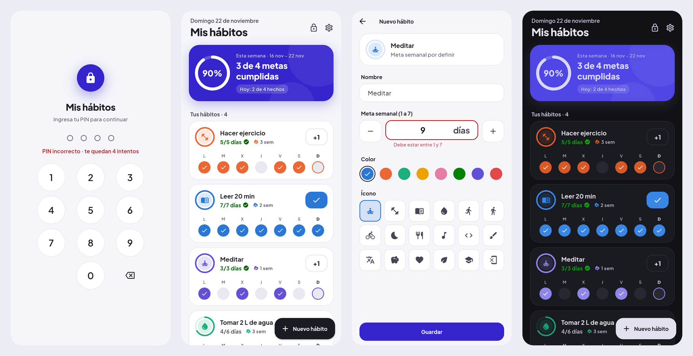
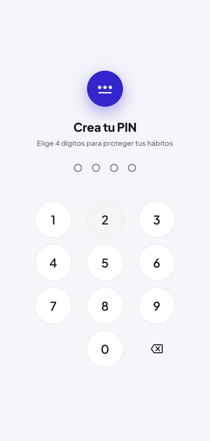
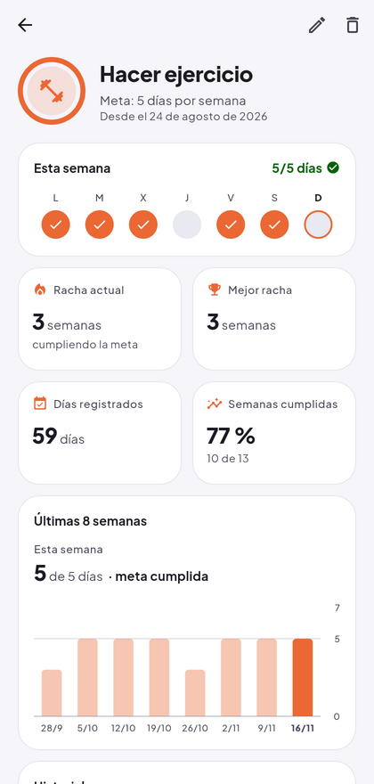
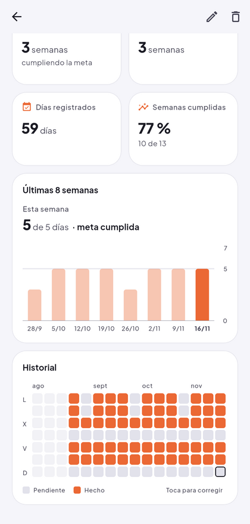
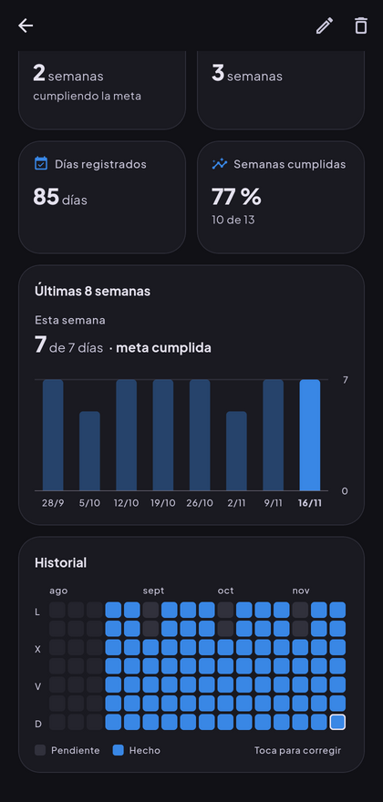

# Mis hábitos

App en **Flutter (Dart)** para seguir hábitos con una **meta semanal**, protegida con **PIN** y con los datos
guardados en una base de datos **SQLite** local. Proyecto del **Equipo 5**.



## Funcionalidades

**Del diseño original**

- 🔒 **Acceso con PIN** de 4 dígitos, con el mensaje "PIN incorrecto".
- ✅ **Lista de hábitos** con avance "3/5 días" y botón **+1**; se pinta de verde al cumplir la meta.
- ➕ **Nuevo hábito** con nombre y meta semanal, validando que **"Debe estar entre 1 y 7"**.

**Nuevas**

- 🗄️ **Base de datos SQLite** (drift): todo se guarda en el teléfono y funciona sin internet.
- 🌙 **Modo oscuro**: claro, oscuro o el del sistema, y la elección se guarda.
- 📅 **Semana tocable**: marca o corrige cualquier día pasado; el +1 se puede deshacer.
- 🔥 **Rachas y estadísticas**: racha actual y mejor racha, % de semanas cumplidas, gráfica de 8 semanas e
  historial de 16 semanas.
- 🎨 **Color e ícono** por hábito, con vista previa en vivo; editar y eliminar.
- 🛡️ **Seguridad del PIN**: guardado con PBKDF2 (nunca en texto plano), bloqueo de 30 s tras 5 intentos y
  bloqueo automático tras 30 s en segundo plano. Cambio de PIN desde Ajustes.
- 🧪 **Hábitos de ejemplo** para presentar la app en segundos.

| Crear PIN | Detalle y estadísticas | Gráfica e historial | Detalle en modo oscuro |
|:-:|:-:|:-:|:-:|
|  |  |  |  |

## ¿Por qué SQLite + drift?

Los datos de esta app son **pocos, personales y relacionales** (un hábito tiene muchos días cumplidos, y se
consulta por semana para calcular avance y rachas), y la app debe funcionar **sin internet** y proteger la
información con un PIN **en el propio teléfono**.

- **SQLite** es una base relacional embebida: un archivo privado dentro de la app, sin servidor, con
  transacciones y SQL real. Las reglas del negocio viven en la propia base: `CHECK (weekly_goal BETWEEN 1 AND 7)`,
  nombres `UNIQUE`, un solo registro por día (`PRIMARY KEY (habit_id, day)`) y borrado en cascada.
- **drift** genera código Dart tipado (los errores salen al compilar, no en el teléfono) y sus consultas
  `watch()` actualizan la pantalla sola al tocar +1.
- **Descartadas:** Firebase y Supabase (exigen internet, cuentas y mandan datos personales a un servidor; el PIN
  local no protegería nada), Hive e Isar (NoSQL sin relaciones ni restricciones; además perdieron a su
  mantenedor original) y sqflite (mismo motor, pero SQL en *strings* y sin reactividad).

👉 Comparación completa, modelo entidad-relación y decisiones de diseño en
[`docs/BASE_DE_DATOS.md`](docs/BASE_DE_DATOS.md).

## Especificaciones

Requisitos funcionales y no funcionales, reglas de validación, cálculo de rachas, arquitectura y pruebas en
[`docs/ESPECIFICACIONES.md`](docs/ESPECIFICACIONES.md).

## Cómo ejecutarla

Requisitos: [Flutter](https://docs.flutter.dev/get-started/install) 3.50 o superior (Dart 3.14).

```bash
git clone https://github.com/Maurimcg/mis-habitos.git
```

```bash
cd mis-habitos
```

```bash
flutter pub get
```

```bash
flutter run
```

La primera vez, la app pide crear un PIN. Para verla con datos, toca **"Cargar hábitos de ejemplo"**.

> La primera compilación descarga SQLite automáticamente (lo hace el paquete `sqlite3`), así que necesita internet.

### Pruebas y análisis

```bash
flutter analyze
```

```bash
flutter test
```

### Si cambias las tablas

El código de la base (`lib/data/database.g.dart`) se genera a partir de `lib/data/database.dart`:

```bash
dart run build_runner build
```

Si el cambio afecta a usuarios con datos, sube `schemaVersion` y agrega la migración en `AppDatabase.migration`.

## Estructura

```
lib/
├── main.dart                 # Inicio: abre la base y arranca la app
├── app.dart                  # MaterialApp, temas claro/oscuro, bloqueo automático
├── core/                     # Fechas, tema y paleta, íconos, hash del PIN
├── data/                     # Tablas drift, repositorios y código generado
├── domain/                   # Estadísticas: avance, rachas, % de semanas
└── ui/
    ├── screens/              # Acceso (PIN), lista, formulario, detalle, ajustes
    └── widgets/              # Teclado de PIN, tarjetas, gráfica, historial
test/                         # 36 pruebas: dominio, base de datos, PIN y pantallas
docs/                         # Especificaciones, base de datos y capturas
```

## Tecnologías

| | |
|---|---|
| Framework | Flutter 3.50 · Dart 3.14 · Material 3 (`material_ui`) |
| Base de datos | SQLite vía [drift](https://drift.simonbinder.eu/) 2.35 + `drift_flutter` |
| Seguridad | `crypto` (PBKDF2-HMAC-SHA256) |
| Fechas en español | `intl` |
| Tipografía | [Plus Jakarta Sans](https://github.com/tokotype/PlusJakartaSans) (licencia SIL OFL, incluida en `assets/fonts/OFL.txt`) |
| CI | GitHub Actions: `flutter analyze` + `flutter test` |
