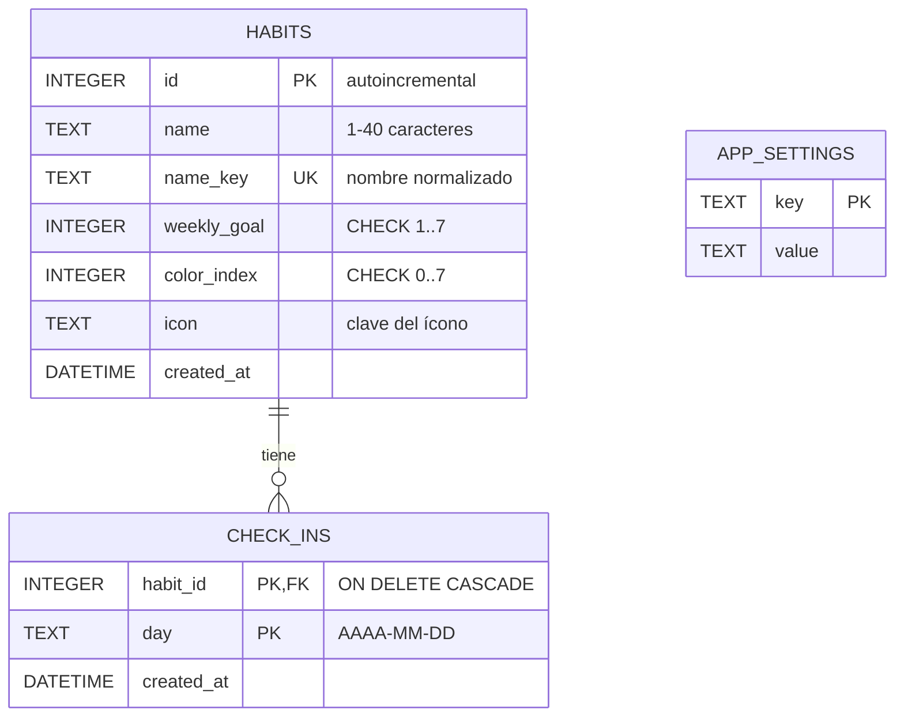

# Base de datos: decisión y diseño

> **Decisión:** SQLite local, usado a través de **drift** (ORM tipado y reactivo para Dart/Flutter).
>
> **En una frase:** los datos de esta app son pocos, personales y **relacionales** (hábitos → días cumplidos,
> consultas por semana, rachas), y deben funcionar **sin internet** y protegidos por un PIN en el propio
> teléfono. Esas condiciones apuntan a una base relacional embebida. SQLite es el estándar para eso, y
> drift lo vuelve seguro de usar desde Dart.

---

## 1. Qué necesita la app de su base de datos

Antes de elegir, listamos lo que la app exige. Cada requisito sale de una pantalla o regla del diseño:

| # | Necesidad | De dónde sale |
|---|-----------|---------------|
| N1 | **Funcionar sin conexión**, siempre. | El hábito se marca en el momento (en el gimnasio, en el metro…). |
| N2 | **Privacidad**: los datos no salen del teléfono. | La app se protege con un PIN propio y no tiene cuentas de usuario. |
| N3 | **Datos relacionales**: un hábito tiene muchos días cumplidos. | "3/5 días", rachas e historial. |
| N4 | **Consultas por rango de fechas y conteos** (días de esta semana, semanas cumplidas). | Pantalla 2 y detalle. |
| N5 | **Integridad**: meta entre 1 y 7, un solo registro por hábito y día, sin nombres repetidos, borrar en cascada. | Validación "Debe estar entre 1 y 7" del diseño. |
| N6 | **UI reactiva**: al tocar +1 la lista se actualiza sola. | Pantalla 2. |
| N7 | **Multiplataforma**: Android e iOS (y de paso escritorio). | Flutter. |
| N8 | **Mantenible por un equipo de estudiantes**: librerías activas, documentadas y fáciles de probar. | Proyecto de equipo. |

Volumen esperado: unos 5–15 hábitos × 365 días ≈ **miles de filas por año**. No es *big data*; cualquier opción
aguanta el volumen, así que la decisión depende de N1–N8 y no del rendimiento bruto.

## 2. Opciones evaluadas

| Opción | Tipo | N1 offline | N2 privacidad | N3/N4 relaciones y consultas | N5 integridad en la BD | N6 reactiva | N8 mantenimiento |
|--------|------|:-:|:-:|:-:|:-:|:-:|:-:|
| **SQLite + drift** ✅ | Relacional embebida | ✅ | ✅ | ✅ SQL, JOIN, COUNT, índices | ✅ CHECK, UNIQUE, FK, PK compuesta | ✅ `watch()` | ✅ muy activa, tipada y probada |
| SQLite + sqflite | Relacional embebida | ✅ | ✅ | ✅ | ✅ | ❌ manual | ⚠️ SQL en *strings*, mapeo a mano; escritorio requiere otro paquete |
| Hive / hive_ce | Clave-valor (NoSQL) | ✅ | ✅ | ❌ sin relaciones ni consultas | ❌ solo en código Dart | ✅ | ⚠️ Hive original sin mantenimiento; vive en un *fork* comunitario |
| Isar | Documentos (NoSQL) | ✅ | ✅ | ⚠️ enlaces y consultas propias | ⚠️ parcial | ✅ | ❌ su autor lo abandonó; depende de un *fork* comunitario |
| ObjectBox | Objetos (NoSQL) | ✅ | ✅ | ⚠️ relaciones propias | ⚠️ parcial | ✅ | ⚠️ el motor nativo se distribuye como binario cerrado |
| Firebase Firestore | Documentos en la nube | ⚠️ solo caché | ❌ datos en servidores de terceros | ⚠️ consultas limitadas, sin JOIN | ⚠️ reglas de seguridad | ✅ | ✅ pero exige proyecto de Google, cuentas y configuración |
| Supabase (PostgreSQL) | Relacional en la nube | ❌ | ❌ | ✅ | ✅ | ✅ | ✅ pero exige servidor, cuentas e internet |
| shared_preferences | Preferencias | ✅ | ✅ | ❌ | ❌ | ❌ | No es una base de datos |

### Por qué no las demás

- **Firebase / Supabase (nube):** resuelven otro problema (sincronizar varios dispositivos o usuarios). Aquí
  romperían N1 y N2: sin internet no hay datos garantizados, la información personal se va a un servidor de
  terceros, y el PIN local dejaría de proteger nada, porque los datos vivirían fuera del teléfono con otra
  autenticación. Además obligan a crear un proyecto, manejar cuentas y posibles costos. Para una app de una
  sola persona en un solo dispositivo es complejidad sin beneficio.
- **Hive, Isar, ObjectBox (NoSQL locales):** son rápidos, pero nuestros datos *son* relacionales. Calcular
  "días de esta semana" o "semanas seguidas cumpliendo la meta" significaría recorrer y filtrar a mano en
  Dart, y reglas como "meta entre 1 y 7" o "un registro por día" quedarían solo en el código: un error en la
  interfaz podría guardar datos inválidos. Además, Hive e Isar quedaron sin su mantenedor original, un
  riesgo real para un proyecto que debe seguir compilando.
- **sqflite:** usa el mismo motor (SQLite) y sería una opción válida, pero obliga a escribir SQL en *strings*
  (los errores aparecen al ejecutar, no al compilar), a mapear filas a objetos a mano y a avisar a la UI de
  cada cambio manualmente. drift hace todo eso por nosotros sobre el mismo SQLite.

## 3. Por qué SQLite + drift

**SQLite** (el motor):

1. **Embebida y sin servidor:** es un archivo dentro de la carpeta privada de la app. Funciona sin internet (N1)
   y los datos no salen del dispositivo (N2).
2. **Relacional con SQL real:** `JOIN`, `COUNT`, rangos de fechas e índices (N3, N4).
3. **Las reglas viven en la base de datos (N5):** `CHECK (weekly_goal BETWEEN 1 AND 7)`, `UNIQUE`, llaves
   foráneas con `ON DELETE CASCADE` y llave primaria compuesta. Aunque la interfaz tuviera un error, la
   base de datos rechaza datos inválidos. Las pruebas lo verifican insertando una meta de 9 directo en la base.
4. **Transacciones ACID:** crear un hábito y comprobar que su nombre no exista ocurre de forma atómica.
5. **Es el estándar:** es el motor de base de datos más desplegado del mundo, viene en Android e iOS, es de
   dominio público y se puede abrir con herramientas como *DB Browser for SQLite* para revisar los datos en clase.
6. **Lo aprendido se reutiliza:** SQL sirve igual en PostgreSQL, MySQL, etc.

**drift** (la capa en Dart):

1. **Tipado y verificado al compilar:** las tablas se declaran en Dart y drift genera el código
   (`database.g.dart`). Un error de nombre o de tipo aparece al compilar, no en el teléfono del usuario.
2. **Reactivo (N6):** `query.watch()` devuelve un `Stream` que emite de nuevo cada vez que cambian las tablas
   consultadas. La lista se actualiza sola al tocar +1, sin código extra.
3. **Migraciones con versión de esquema:** `schemaVersion` y `MigrationStrategy` permiten evolucionar las
   tablas sin perder los datos de quien ya usa la app.
4. **Multiplataforma (N7):** Android, iOS, Windows, macOS, Linux (y web con WebAssembly).
5. **Fácil de probar (N8):** `NativeDatabase.memory()` crea una base en memoria; el proyecto tiene 18 pruebas
   de base de datos que corren en milisegundos.

## 4. Modelo de datos



Este es el esquema **real** que drift crea en SQLite (extraído de la base con `sqlite_master`):

```sql
CREATE TABLE "habits" (
  "id"          INTEGER NOT NULL PRIMARY KEY AUTOINCREMENT,
  "name"        TEXT    NOT NULL CHECK(LENGTH("name") BETWEEN 1 AND 40),
  "name_key"    TEXT    NOT NULL UNIQUE,
  "weekly_goal" INTEGER NOT NULL CHECK("weekly_goal" BETWEEN 1 AND 7),
  "color_index" INTEGER NOT NULL DEFAULT 0 CHECK("color_index" BETWEEN 0 AND 7),
  "icon"        TEXT    NOT NULL DEFAULT 'spa',
  "created_at"  INTEGER NOT NULL DEFAULT (CAST(strftime('%s', CURRENT_TIMESTAMP) AS INTEGER))
);

CREATE TABLE "check_ins" (
  "habit_id"   INTEGER NOT NULL REFERENCES habits (id) ON DELETE CASCADE,
  "day"        TEXT    NOT NULL CHECK(LENGTH("day") = 10),
  "created_at" INTEGER NOT NULL DEFAULT (CAST(strftime('%s', CURRENT_TIMESTAMP) AS INTEGER)),
  PRIMARY KEY ("habit_id", "day")
);
CREATE INDEX check_ins_day ON check_ins (day);

CREATE TABLE "app_settings" (
  "key"   TEXT NOT NULL,
  "value" TEXT NOT NULL,
  PRIMARY KEY ("key")
);
```

### Decisiones de diseño

| Decisión | Por qué |
|----------|---------|
| Se guarda **un registro por día cumplido**, no un contador "3/5". | El progreso semanal se **calcula** (`COUNT` en la semana); nunca puede quedar desincronizado. Además permite rachas, historial y corregir días pasados. Con un contador nada de eso sería posible. |
| `PRIMARY KEY (habit_id, day)` | Garantiza a nivel de base de datos que un hábito no se marque dos veces el mismo día, y sirve de índice para leer los días de un hábito. |
| `day` como texto `AAAA-MM-DD` (fecha local) | Un "día" no tiene hora ni zona horaria: guardar un *timestamp* haría que cerca de medianoche o con cambio de horario un registro cayera en otro día. Como texto ISO se ordena bien, sirve para rangos (`BETWEEN '2026-11-16' AND '2026-11-22'`) y se lee fácil. |
| `name_key` UNIQUE (nombre normalizado) | Impide duplicados como "Meditar" y " MEDÍTAR " (ignora mayúsculas, acentos y espacios, pero respeta la ñ: "Año" ≠ "Ano"). La regla la hace cumplir la base de datos, no solo la interfaz. |
| `CHECK (weekly_goal BETWEEN 1 AND 7)` | Es la regla del diseño ("Debe estar entre 1 y 7") aplicada también en la base. |
| `ON DELETE CASCADE` + `PRAGMA foreign_keys = ON` | Al borrar un hábito se borra su historial; no quedan registros huérfanos. SQLite trae las llaves foráneas apagadas por defecto: se encienden al abrir la conexión. |
| `color_index` (0–7) y no un color ARGB | El mismo índice se pinta con un tono distinto en modo claro y oscuro. La paleta de 8 colores está validada para daltonismo. |
| Índice `check_ins_day` | Acelera las consultas por rango de fechas entre todos los hábitos. |
| `app_settings` clave-valor | Preferencias heterogéneas (tema, hash del PIN, intentos fallidos) sin migrar el esquema por cada ajuste nuevo. |
| Archivo en *Application Support* | Carpeta privada de la app en cada sistema (no en "Documentos"), que el usuario no ve ni comparte por accidente. |

### El PIN en la base de datos

- **Nunca se guarda el PIN.** Se guarda una sal aleatoria de 16 bytes, el número de iteraciones y el resultado de
  **PBKDF2-HMAC-SHA256** con 120 000 iteraciones (≈ 0.4 s, calculado en otro *isolate* para no congelar la
  interfaz). La implementación se verifica contra el vector de prueba del RFC 7914 y contra `hashlib` de Python.
- **Intentos limitados:** tras 5 errores la app se bloquea 30 segundos. El contador y la hora de desbloqueo se
  guardan en la base, así cerrar y abrir la app no reinicia los intentos.
- **Límite honesto:** con solo 10 000 PIN posibles, quien copie el archivo de la base podría probarlos todos sin
  conexión. El PIN protege contra quien toma el teléfono desbloqueado, no contra un análisis forense del
  archivo. Por eso la base vive en la carpeta privada de la app (protegida por el sistema operativo). Si se
  necesitara más, el siguiente paso es cifrar el archivo completo con SQLCipher / SQLite3MultipleCiphers (ver
  *Trabajo futuro* en las especificaciones).

## 5. Consultas principales

| Uso | Consulta (drift) | Notas |
|-----|------------------|-------|
| Lista de hábitos con sus días | `select(habits).join([leftOuterJoin(checkIns, …)]).watch()` | Una sola consulta y un solo `Stream`; se recalcula sola al cambiar cualquiera de las dos tablas. |
| Marcar / desmarcar un día | `DELETE … WHERE habit_id = ? AND day = ?`; si no borró nada, `INSERT` | En una transacción. Rechaza días futuros. |
| ¿Nombre repetido? | `SELECT … WHERE name_key = ?` | Dentro de la misma transacción que el `INSERT`. |
| Borrar hábito | `DELETE FROM habits WHERE id = ?` | Los días se borran por `CASCADE`. |

Las estadísticas (progreso semanal, rachas, % de semanas cumplidas) se calculan en `lib/domain/habit_stats.dart`
a partir de los días, como funciones puras con sus propias pruebas.
