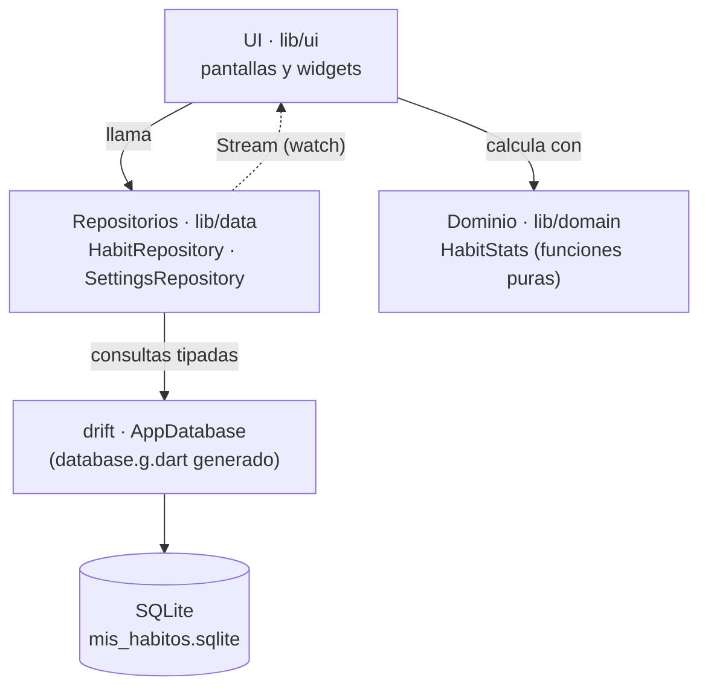

# Especificaciones: Mis hábitos

| | |
|---|---|
| **Proyecto** | Mis hábitos, app móvil de seguimiento de hábitos semanales |
| **Equipo** | Equipo 5 |
| **Versión** | 1.0.0 |
| **Tecnología** | Flutter 3.50 · Dart 3.14 · SQLite (drift 2.35) |
| **Plataformas** | Android, iOS (también Windows, macOS y Linux) |

---

## 1. Propósito y alcance

Mis hábitos ayuda a una persona a cumplir hábitos con una **meta semanal** (por ejemplo, "Hacer ejercicio 5 días
por semana"). Cada día que cumple un hábito lo registra con **+1**, y la app muestra su avance de la semana,
sus rachas y su historial.

**Dentro del alcance:** un solo usuario por dispositivo, acceso con PIN, datos guardados solo en el teléfono
(sin cuentas ni internet).

**Fuera del alcance (v1):** sincronización entre dispositivos, recordatorios con notificaciones, varios usuarios.

## 2. Pantallas

El diseño original del equipo definió tres pantallas. Esta versión las conserva y agrega dos más.

| # | Pantalla | Diseño original | Implementación |
|---|----------|-----------------|----------------|
| 1 | **Acceso** | Candado, título "Mis hábitos", campo de PIN, botón *Entrar*, error "PIN incorrecto". | Teclado numérico propio con 4 puntos. Se valida al completar el 4.º dígito (no hace falta *Entrar*). La primera vez pide **crear** y **confirmar** el PIN. Error "PIN incorrecto · te quedan N intentos" con vibración. También acepta el teclado físico. |
| 2 | **Mis hábitos** | Lista de hábitos con "3/5 días" y botón **+1**; "7/7 días" en verde al cumplir; botón flotante **+**. | Tarjetas con ícono y anillo de progreso, "3/5 días" (verde ✓ al cumplir), botón **+1** (se vuelve ✓ al registrar hoy), los 7 días de la semana tocables y racha 🔥. Arriba, un resumen de la semana. Botón flotante "Nuevo hábito". |
| 3 | **Nuevo hábito** | Campo *Nombre*, campo *Meta semanal (1 a 7)* con el error "Debe estar entre 1 y 7", botón *Guardar*. | Mismos campos y el **mismo mensaje de error**, con botones − / + para la meta, selector de color e ícono y vista previa en vivo. Sirve también para **editar**. |
| 4 | **Detalle del hábito** *(nueva)* | — | Racha actual y mejor racha, días registrados, % de semanas cumplidas, gráfica de las últimas 8 semanas con la línea de la meta e historial de 16 semanas en cuadrícula (se puede tocar un día para corregirlo). Editar y eliminar. |
| 5 | **Ajustes** *(nueva)* | — | Tema Sistema / Claro / **Oscuro**, cambiar PIN, bloquear ahora, información de la base de datos y borrar todo. |

Capturas: ver [`docs/capturas`](capturas/) y el [README](../README.md).

## 3. Requisitos funcionales

| ID | Requisito | Pantalla |
|----|-----------|----------|
| RF-01 | La primera vez, la app pide crear un PIN de 4 dígitos y confirmarlo. Si la confirmación no coincide, lo vuelve a pedir. | 1 |
| RF-02 | Para entrar se ingresa el PIN. Si es incorrecto se muestra "PIN incorrecto" y cuántos intentos quedan. | 1 |
| RF-03 | Tras **5 intentos fallidos** la app se bloquea **30 segundos** con cuenta regresiva. El bloqueo persiste aunque se cierre la app. | 1 |
| RF-04 | La app se bloquea de nuevo si pasa **30 s en segundo plano**, o al tocar el candado. | 2, 5 |
| RF-05 | Se muestran todos los hábitos con su avance de la semana actual ("X/Y días"). Al cumplir la meta el texto se pinta de verde con ✓. | 2 |
| RF-06 | El botón **+1** registra el día de hoy. Si hoy ya está registrado, al tocarlo se quita el registro y se ofrece **Deshacer**. | 2 |
| RF-07 | Se puede marcar o desmarcar cualquier día pasado de la semana tocándolo. Los días futuros no se pueden marcar. | 2, 4 |
| RF-08 | Al completar la meta semanal se muestra el aviso "¡Meta semanal cumplida!". | 2, 4 |
| RF-09 | Se puede crear un hábito con nombre, meta semanal (1 a 7), color e ícono. | 3 |
| RF-10 | Se puede editar y eliminar un hábito. Eliminar pide confirmación y borra su historial. | 3, 4 |
| RF-11 | El detalle muestra racha actual, mejor racha, días totales, % de semanas cumplidas, gráfica de 8 semanas e historial de 16 semanas, donde se puede corregir cualquier día pasado. | 4 |
| RF-12 | Se puede elegir tema claro, oscuro o el del sistema; la elección se guarda. | 5 |
| RF-13 | Se puede cambiar el PIN (PIN actual → nuevo → confirmación). | 5 |
| RF-14 | Se pueden cargar hábitos de ejemplo con historial (para presentar la app) y borrar todos los datos. | 2, 5 |

## 4. Reglas de validación

Cada regla se valida **en la interfaz** (mensaje inmediato) y, cuando aplica, **también en la base de datos**
(no se puede guardar un dato inválido aunque la interfaz fallara).

| Campo | Regla | Mensaje | En la BD |
|-------|-------|---------|----------|
| PIN | Exactamente 4 dígitos | (el teclado solo permite dígitos) | — |
| PIN (confirmación) | Igual al primero | "Los PIN no coinciden. Inténtalo de nuevo" | — |
| PIN (entrada) | Coincide con el guardado | "PIN incorrecto · te quedan N intentos" | Contador de intentos persistente |
| Nombre | Obligatorio, 1 a 40 caracteres (sin espacios sobrantes) | "Escribe un nombre" / "Máximo 40 caracteres" | `CHECK(LENGTH(name) BETWEEN 1 AND 40)` |
| Nombre | Único, sin importar mayúsculas, acentos ni espacios | "Ya tienes un hábito con ese nombre" | `name_key UNIQUE` |
| Meta semanal | Número entero entre 1 y 7 | **"Debe estar entre 1 y 7"** | `CHECK(weekly_goal BETWEEN 1 AND 7)` |
| Registro diario | Un registro por hábito y día | (el botón alterna) | `PRIMARY KEY(habit_id, day)` |
| Registro diario | No se permiten días futuros | (los días futuros están deshabilitados) | Validado en el repositorio |

## 5. Definiciones de cálculo

- **Semana:** de lunes a domingo (fecha local).
- **Avance semanal:** días registrados en la semana actual / meta semanal.
- **Meta cumplida:** días de la semana ≥ meta.
- **Racha actual:** semanas consecutivas cumpliendo la meta, contando hacia atrás. La semana en curso suma si ya
  se cumplió, y **no rompe** la racha si todavía no (aún quedan días).
- **Mejor racha:** la racha más larga del historial.
- **% de semanas cumplidas:** semanas cumplidas / semanas terminadas desde la semana de creación (la semana en
  curso cuenta solo si ya se cumplió).
- Se calcula con la meta **actual** del hábito; si se edita la meta, el historial se reinterpreta con la nueva.

## 6. Requisitos no funcionales

| ID | Requisito | Cómo se cumple |
|----|-----------|----------------|
| RNF-01 | **Sin conexión**: todo funciona sin internet. | Base de datos SQLite local. |
| RNF-02 | **Privacidad**: los datos no salen del dispositivo. | Sin servidores ni analíticas. El archivo vive en la carpeta privada de la app. |
| RNF-03 | **Seguridad del PIN**: nunca en texto plano. | PBKDF2-HMAC-SHA256, 120 000 iteraciones, sal aleatoria de 16 bytes, comparación en tiempo constante. |
| RNF-04 | **Integridad de datos**. | CHECK, UNIQUE, llaves foráneas con cascada y transacciones. |
| RNF-05 | **Respuesta inmediata**: la lista se actualiza al instante tras +1. | Consultas reactivas de drift (`watch()`); el hash del PIN corre en otro *isolate*. |
| RNF-06 | **Accesibilidad**. | Etiquetas de lector de pantalla en botones, días y gráficas; el estado nunca se comunica solo con color (✓, texto, ícono); paleta validada para daltonismo; objetivos táctiles ≥ 44 px. |
| RNF-07 | **Modo claro y oscuro**. | Dos temas Material 3 con tonos propios para cada modo. |
| RNF-08 | **Idioma**: español. | Textos, fechas (`intl`) y componentes de Material en español. |
| RNF-09 | **Mantenibilidad**. | Capas separadas (datos / dominio / UI), código generado y tipado, `flutter analyze` sin advertencias, pruebas automáticas e integración continua. |

## 7. Arquitectura



- **UI** no escribe SQL: usa los repositorios, que se inyectan con `AppScope` (un `InheritedWidget`).
- **Repositorios** encapsulan las consultas, las transacciones y las reglas (duplicados, días futuros, PIN).
- **Dominio**: las estadísticas son funciones puras de Dart, fáciles de probar.
- **Bloqueo**: la pantalla de PIN se dibuja encima de todo el navegador, así cubre cualquier pantalla abierta.

```
lib/
├── main.dart                  # Inicio: abre la base y arranca la app
├── app.dart                   # MaterialApp, temas, bloqueo automático
├── core/                      # Fechas, tema, íconos, hash del PIN
├── data/                      # drift: tablas, repositorios, código generado
├── domain/                    # Estadísticas (rachas, % de semanas)
└── ui/                        # Pantallas, widgets y acciones
```

## 8. Pruebas

`flutter test` ejecuta 36 pruebas:

| Archivo | Qué cubre |
|---------|-----------|
| `test/habit_stats_test.dart` | Semanas de lunes a domingo, cambio de mes y de año, horario de verano, avance, rachas, % de semanas. |
| `test/database_test.dart` | CRUD, nombres duplicados, CHECK de la meta y de las longitudes (incluso con SQL directo), llave primaria compuesta, cascada, llave foránea, días futuros, streams reactivos, PIN guardado como hash, bloqueo tras 5 intentos y desbloqueo a los 30 s, tema. |
| `test/pin_hasher_test.dart` | PBKDF2 contra el vector del RFC 7914 y contra `hashlib` de Python. |
| `test/widget_test.dart` | Flujo completo de primer uso (crear y confirmar PIN, PIN incorrecto), validación "Debe estar entre 1 y 7", guardado en la base y aviso de nombre repetido. |

La integración continua (GitHub Actions) corre `flutter analyze` y `flutter test` en cada *push*.

## 9. Limitaciones conocidas y trabajo futuro

- **Recordatorios** con notificaciones locales a una hora elegida.
- **Cifrado completo del archivo** con SQLite3MultipleCiphers (soportado por el paquete `sqlite3` con
  `hooks: user_defines: sqlite3: source: sqlite3mc`), derivando la llave del PIN. Implica que olvidar el PIN
  significaría perder los datos.
- **Olvidé mi PIN:** hoy la única salida es borrar los datos de la app desde el sistema.
- **Respaldo / exportación** (JSON o CSV) para cambiar de teléfono.
- **Historial de metas:** guardar la meta vigente de cada semana para que editar la meta no reinterprete semanas pasadas.
- **Sincronización** opcional entre dispositivos (ahí sí tendría sentido un backend en la nube).
